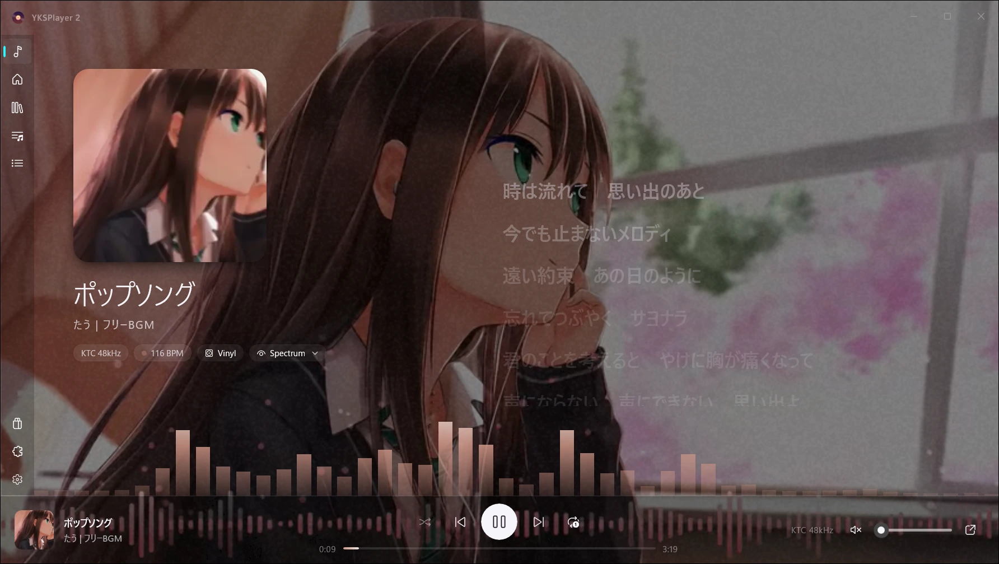
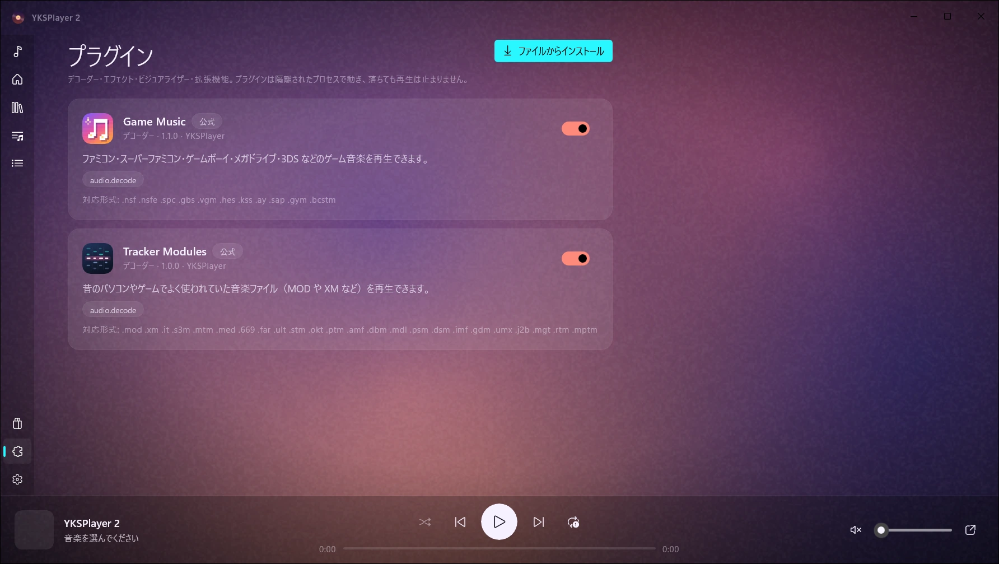
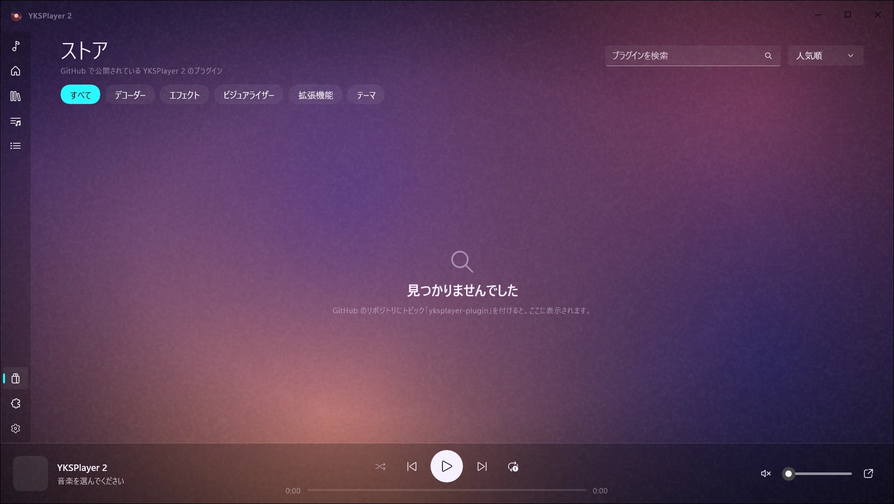

<div align="center">

# YKSPlayer 2 SDK

YKSPlayer 2 のプラグインを作るための開発キット

[](https://github.com/CreamDevelopers/YKSPlayer2-SDK/actions/workflows/ci.yml)
[](LICENSE)


[公式サイト](https://yks.creamdev.org) ・ [ドキュメント](#ドキュメント) ・ [変更履歴](CHANGELOG.md) ・ [English](#english)



</div>

## 目次

- [できること](#できること)
- [しくみと安全性](#しくみと安全性)
- [必要なもの](#必要なもの)
- [はじめかた](#はじめかた)
- [拡張機能の API](#拡張機能の-api)
- [yks-plugin.json](#yks-pluginjson)
- [権限](#権限)
- [パッケージと署名](#パッケージと署名)
- [ストアで公開する](#ストアで公開する)
- [リポジトリの構成](#リポジトリの構成)
- [ドキュメント](#ドキュメント)
- [バージョンと互換性](#バージョンと互換性)
- [SDK の開発](#sdk-の開発)
- [ライセンス](#ライセンス)

## できること

YKSPlayer 2 は、プラグインで対応形式や機能を増やせる Windows 用の音楽プレイヤーです。この SDK で、次の 5 種類のプラグインを作れます。

| 種類 | できること | 書く言語 | 動く場所 |
|---|---|---|---|
| デコーダー | 新しい音声形式を再生する | C、C++、Rust など C の ABI を出せる言語 | 隔離されたホストプロセス |
| エフェクト | 再生中の音を加工する | 同上 | 隔離されたホストプロセス |
| ビジュアライザー | 音楽に合わせて映像を描く | HLSL のピクセルシェーダー | GPU だけ。CPU のコードは動かない |
| 拡張機能 | パネル、コマンド、歌詞、翻訳、読み方、ライブラリ操作、ストリーミング、描画するビジュアライザー | .NET、または標準入出力で JSON-RPC を話せる任意の言語 | 隔離されたプロセス |
| テーマ | 色と背景画像を変える | JSON と画像 | コードは動かない |

公式プラグインの MOD・XM・IT 再生 libxmp と、ゲーム音楽再生 Game_Music_Emu も、この SDK だけで作られています。



## しくみと安全性

プレイヤーは、すべてのプラグインを信頼できないコードとして扱います。

- デコーダーとエフェクトは、インスタンスごとに別プロセスの `yks-plugin-host.exe` で動きます。
- 拡張機能も専用のプロセスで動き、プレイヤーとは JSON-RPC だけでやり取りします。届いた呼び出しは、ユーザーが許可した権限と毎回照らし合わせます。
- どのプロセスも整合性レベルを下げ、ジョブオブジェクトで囲んでいます。ユーザーのファイルやレジストリには書き込めず、メモリは 512 MB までです。
- プラグインが落ちても固まっても、止まるのはそのプラグインだけです。曲がスキップされるかエフェクトが外れるだけで、再生は続きます。3 回失敗したプラグインは自動で無効になります。
- デコーダーはファイルを自分で開きません。プレイヤーがファイルの中身を渡します。
- パッケージは署名付きです。更新は同じ鍵で署名されたものしか受け付けません。

詳しくは [docs/security.md](docs/security.md) を見てください。

## 必要なもの

| 作るもの | 必要なもの |
|---|---|
| すべて | Windows 10 または 11 の 64 ビット版、[.NET 10 SDK](https://dotnet.microsoft.com/download) |
| デコーダー、エフェクト | Visual Studio 2022 の C++ ツール、CMake 3.20 以降 |
| ビジュアライザー | Windows SDK に入っている `fxc.exe` |
| 動作確認 | [YKSPlayer 2](https://yks.creamdev.org) |

## はじめかた

まずリポジトリを取得し、テンプレートを入れます。

```powershell
git clone https://github.com/CreamDevelopers/YKSPlayer2-SDK.git
cd YKSPlayer2-SDK
dotnet new install ./templates/native-effect
dotnet new install ./templates/native-decoder
dotnet new install ./templates/extension
```

署名用の鍵を一度だけ作ります。`me.key.pem` は秘密にして、なくさないようにしてください。同じ鍵がないと、あとで更新を配れません。

```powershell
dotnet run --project tools/yks-pack -- keygen me
```

できた `.ykspkg` は、YKSPlayer 2 のウィンドウにドロップするかダブルクリックすると入ります。

### エフェクトを C++ で作る

```powershell
dotnet new yks-effect -n Warmth --publisher alice
cmake -S Warmth -B Warmth/build -A x64
cmake --build Warmth/build --config Release
dotnet run --project tools/yks-pack -- pack Warmth/build/Release --key me.key.pem
```

`effect.cpp` の `process` を書き換えます。パラメーターを宣言すると、プレイヤーがスライダーを作ります。音声スレッドで動くので、`process` の中ではメモリの確保、ロック、ファイルの読み書きをしないでください。

```cpp
const yks_param_desc kParams[] = {
    {"gain", "Gain", -24, 24, 0, "dB"},
};

void YKS_PLUGIN_CALL process(void* inst, float* io, uint32_t frames) {
    auto* s = static_cast<State*>(inst);
    const float g = float(std::pow(10.0, s->gain_db / 20.0));
    for (uint32_t i = 0; i < frames * s->channels; ++i) io[i] *= g;
}
```

### デコーダーを C で作る

```powershell
dotnet new yks-decoder -n Tracker --publisher alice --extension .trk
cmake -S Tracker -B Tracker/build -A x64
cmake --build Tracker/build --config Release
```

デコーダーは、プレイヤーから渡されたファイルの中身を読み、浮動小数点の PCM を返します。シーク、タグ、コーデック名も返せます。WAV、FLAC、MP3 などプレイヤーに入っている形式は、常にそちらが優先されます。実装例は [samples/native/sine-decoder](samples/native/sine-decoder) にあります。

### 拡張機能を C# で作る

```powershell
dotnet new yks-extension -n NowPlayingPanel --publisher alice
dotnet build NowPlayingPanel -c Release -o NowPlayingPanel/out
dotnet run --project tools/yks-pack -- pack NowPlayingPanel/out --key me.key.pem
```

`Extension` を継承し、必要なところだけを上書きします。どのメソッドにも、何もしない既定の動きがあります。

```csharp
using YKSPlayer.Sdk.Extensions;

public sealed class NowPlayingPanel : Extension
{
    private string _title = "-";

    public override IReadOnlyList<PanelInfo> Panels => [new("now", "いま聴いている曲")];

    public override Task<Panel?> RenderPanelAsync(string id) =>
        Task.FromResult<Panel?>(new Panel("いま聴いている曲", [
            Block.Heading(_title),
            Block.Button("次の曲へ", "next"),
        ]));

    public override Task OnTrackChangedAsync(TrackInfo track)
    {
        _title = track.Title;
        return Host.InvalidatePanelAsync("now");
    }

    public override async Task<string?> ExecuteCommandAsync(string id)
    {
        if (id == "next") await Host.ControlPlaybackAsync("next");
        return null;
    }
}
```

この例では `playback.read`、`playback.control`、`ui.panel` の権限を `yks-plugin.json` に書きます。

### ビジュアライザーを HLSL で作る

Direct2D のピクセルシェーダーを書いて `.cso` にコンパイルします。プレイヤーは、宣言されている変数にだけ値を入れます。

```hlsl
#define D2D_INPUT_COUNT 0
#include "d2d1effecthelpers.hlsli"

float2 resolution;
float pulse;
float4 accent;
float4 bands[16];

D2D_PS_ENTRY(main)
{
    float2 uv = D2DGetScenePosition().xy / resolution;
    uint i = (uint)(uv.x * 63);
    float bar = step(1 - uv.y, bands[i >> 2][i & 3]);
    return float4(accent.rgb * bar * (0.7 + 0.3 * pulse), bar);
}
```

使える変数は、描画範囲の大きさ、経過時間、ビートの強さ、サビの光、ジャケットから取った色、64 本のスペクトラムです。一覧は [docs/visualizers.md](docs/visualizers.md) にあります。

## 拡張機能の API

`Host` からプレイヤーを操作し、`Extension` のメソッドを上書きしてプレイヤーからの依頼に答えます。

| できること | 上書きするもの、呼ぶもの | 必要な権限 |
|---|---|---|
| パネルを出す | `Panels`、`RenderPanelAsync`、`Host.InvalidatePanelAsync` | `ui.panel` |
| メニューにコマンドを足す | `Commands`、`ExecuteCommandAsync` | `ui.command` |
| 曲の右クリックメニューに足す | `TrackCommands`、`ExecuteTrackCommandAsync` | `ui.command` |
| 曲の変化や再生位置を知る | `OnTrackChangedAsync`、`OnStateChangedAsync`、`OnPositionAsync` | `playback.read` |
| 再生を操作する | `Host.ControlPlaybackAsync`、`PlayAsync`、`SeekAsync`、`SetVolumeAsync` | `playback.control` |
| 歌詞を提供する | `ProvidesLyrics`、`GetLyricsAsync` | `lyrics.provide` |
| 歌詞を翻訳する | `TranslatesLyrics`、`TranslateLyricsAsync` | `lyrics.translate` |
| 歌詞の読み方をカタカナで付ける | `PronouncesLyrics`、`PronounceLyricsAsync` | `lyrics.pronounce` |
| ジャケットや曲名を補う | `ProvidesMetadata`、`GetMetadataAsync` | `metadata.provide` |
| ライブラリとプレイリストを読む | `QueryLibraryAsync`、`PlaylistsAsync`、`PlaylistTracksAsync` | `library.read` |
| ライブラリに曲を足す、プレイリストを作る | `AddToLibraryAsync`、`CreatePlaylistAsync`、`SetPlaylistTracksAsync` | `library.write` |
| ネットの音源を「ソース」に並べる | `Sources`、`BrowseAsync`、`ResolveAsync`、`PlayItemsAsync` | `source.provide`、`net` |
| コードでビジュアライザーを描く | `Visualizers`、`RenderVisualizerAsync` | `visualizer.draw` |
| 補助プログラムを動かす | 普段どおり `Process.Start` を使う | `process.run` |
| 設定項目を出す | `yks-plugin.json` の `settings`、`Host.Settings`、`OnSettingsChangedAsync` | なし |

翻訳と読み方は別々の欄に表示されるので、翻訳プラグインと読み方プラグインは一緒に使えます。歌詞の翻訳はこう書きます。

```csharp
public sealed class Translator : Extension
{
    public override bool TranslatesLyrics => true;

    public override async Task<LyricsTranslateResult?> TranslateLyricsAsync(LyricsTranslateQuery q, CancellationToken ct)
    {
        // q.Lines は歌詞の各行、q.Target は "ja" や "en" などの翻訳先です。
        // 同じ数、同じ順番で返します。訳がない行は "" にします。
        var lines = new List<string>();
        foreach (var line in q.Lines) lines.Add(line.Length == 0 ? "" : await MyService.TranslateAsync(line, q.Target, ct));
        return new LyricsTranslateResult(lines);
    }
}
```

.NET 以外の言語で書くときは、`yks-plugin.json` の `extension.runtime` を `exe` にして、標準入出力で 1 行に 1 つの JSON-RPC メッセージをやり取りします。メソッドの一覧は [docs/extension-protocol.md](docs/extension-protocol.md) にあります。

## yks-plugin.json

どのプラグインも、パッケージの一番上に `yks-plugin.json` を置きます。

```json
{
  "schema": 1,
  "id": "alice.now-playing-panel",
  "name": "いま聴いている曲",
  "version": "1.0.0",
  "publisher": "Alice",
  "description": "再生中の曲をパネルに表示します。",
  "license": "MIT",
  "repository": "https://github.com/alice/now-playing-panel",
  "kind": "extension",
  "entry": "NowPlayingPanel.dll",
  "icon": "icon.svg",
  "extension": { "runtime": "dotnet" },
  "engines": { "yksplayer": ">=2.4.0 <3.0.0" },
  "permissions": ["playback.read", "playback.control", "ui.panel"]
}
```

| キー | 意味 |
|---|---|
| `id` | 小文字で `作者.名前` の形にします。バージョンが変わっても変えません。 |
| `version` | プラグイン自体のバージョンです。SemVer で書きます。 |
| `kind` | `decoder`、`dsp`、`visualizer`、`extension`、`theme` のどれかです。 |
| `entry` | パッケージの中の本体です。ネイティブなら `.dll`、ビジュアライザーなら `.cso`、拡張機能なら `.dll` か `.exe` です。 |
| `engines.yksplayer` | 対応するプレイヤーのバージョンの範囲です。範囲外のプレイヤーでは表示も導入もされません。 |
| `engines.pluginAbi` | ネイティブプラグインだけに必要です。今は `1` です。 |
| `permissions` | 必要な権限です。何もいらなければ空の配列にします。 |
| `repository` | GitHub のリポジトリです。プレイヤーが更新を探すのに使います。 |

ほかのキーと細かい決まりは [docs/manifest.md](docs/manifest.md) にあります。

## 権限

導入するとき、プレイヤーは権限をわかりやすい言葉で見せ、ユーザーが同意してから有効にします。必要な権限だけを書いてください。

| 権限 | 許すこと |
|---|---|
| `audio.decode` | 再生するファイルの中身を受け取る |
| `audio.process` | 再生中の音を加工する |
| `playback.read` | 再生中の曲と状態を知る |
| `playback.control` | 再生、一時停止、曲送り、シーク、音量を操作する |
| `library.read` | ライブラリとファイルの場所を読む |
| `library.write` | ライブラリに曲を足し、プレイリストを作る |
| `lyrics.provide` | 歌詞を提供する |
| `lyrics.translate` | 再生中の曲の歌詞を受け取って翻訳する |
| `lyrics.pronounce` | 再生中の曲の歌詞を受け取って読み方を付ける |
| `metadata.provide` | ジャケットや曲名を補う |
| `ui.panel` | パネルと短い通知を出す |
| `ui.command` | メニューにコマンドを足し、ブラウザでページを開く |
| `source.provide` | 「ソース」ページにネットの音源を並べる |
| `visualizer.draw` | コードでビジュアライザーを描く |
| `process.run` | 補助プログラムを同じ制限の中で動かす |
| `net`、`net:example.com` | インターネットにつなぐ。接続先を書くと、その名前がユーザーに見えます |

更新で権限が増えると、プラグインは無効の状態で入り、ユーザーがもう一度同意するまで動きません。

## パッケージと署名

配布形式の `.ykspkg` は、全ファイルの SHA-256 と ECDSA P-256 の署名が入った zip です。`yks-pack` で作ります。

```powershell
dotnet run --project tools/yks-pack -- keygen me
dotnet run --project tools/yks-pack -- validate path/to/build
dotnet run --project tools/yks-pack -- pack path/to/build --key me.key.pem
dotnet run --project tools/yks-pack -- verify alice.my-plugin-1.0.0.ykspkg
```

上から順に、鍵の作成、`yks-plugin.json` の検証、パッケージ化と署名、署名の確認です。リリースを公開すると、ビルド済みの `yks-pack.exe` と NuGet パッケージ `YKSPlayer.Sdk` が [Releases](https://github.com/CreamDevelopers/YKSPlayer2-SDK/releases) に添付されます。

## ストアで公開する

YKSPlayer 2 のプラグインストアには専用のサーバーがありません。GitHub のリポジトリをそのまま読みます。



1. リポジトリの一番上に `yks-plugin.json`、`README.md`、`LICENSE` を置きます。README がストアの紹介ページになります。
2. リポジトリにトピック `yksplayer-plugin` を付けます。種類ごとのタブに出すには、`yksplayer-decoder`、`yksplayer-effect`、`yksplayer-visualizer`、`yksplayer-extension`、`yksplayer-theme` のどれかも付けます。
3. `yks-plugin.json` と同じバージョンのタグでリリースを作り、`.ykspkg` を添付します。

ストアは、`.ykspkg` が付いた一番新しいリリースを表示します。古いバージョンを入れている人には「更新」が出ます。GitHub Actions で自動リリースする方法は [docs/publishing.md](docs/publishing.md) にあります。

## リポジトリの構成

| 場所 | 中身 |
|---|---|
| [include/yks/yks_plugin.h](include/yks/yks_plugin.h) | デコーダーとエフェクトのネイティブ ABI |
| [dotnet/YKSPlayer.Sdk](dotnet/YKSPlayer.Sdk) | マニフェスト、パッケージと署名、拡張機能の API |
| [dotnet/YKSPlayer.Sdk.Tests](dotnet/YKSPlayer.Sdk.Tests) | SDK のテスト |
| [tools/yks-pack](tools/yks-pack) | 鍵の作成、検証、パッケージ化、署名の確認をするツール |
| [samples/native](samples/native) | 正弦波を鳴らす C のデコーダーと、C++ のビットクラッシャー |
| [samples/visualizer-nebula](samples/visualizer-nebula) | シェーダーのビジュアライザー |
| [samples/extension-diary](samples/extension-diary) | 聴いた曲を日記のように残すパネル |
| [templates](templates) | `dotnet new` 用のテンプレート |
| [docs](docs) | 仕様書 |

## ドキュメント

| 文書 | 内容 |
|---|---|
| [manifest.md](docs/manifest.md) | `yks-plugin.json` のすべてのキーと権限 |
| [native-abi.md](docs/native-abi.md) | デコーダーとエフェクトの関数、スレッド、エラーの決まり |
| [extension-protocol.md](docs/extension-protocol.md) | 拡張機能の JSON-RPC のメソッドとパネルの部品 |
| [visualizers.md](docs/visualizers.md) | シェーダーに渡される値とテンプレート |
| [security.md](docs/security.md) | 隔離のしくみ、クラッシュの扱い、署名 |
| [publishing.md](docs/publishing.md) | ストアへの公開と自動リリース |
| [VERSIONING.md](VERSIONING.md) | SDK、ABI、プロトコル、マニフェストのバージョンの決まり |

仕様書は英語で書いています。

## バージョンと互換性

- ネイティブ ABI 1、拡張機能のプロトコル 1、マニフェストのスキーマ 1 で作ったプラグインは、YKSPlayer 2.x のどのバージョンでも動き続けます。
- 機能は足すだけで、既存のものの意味は変えません。プレイヤーが知らないメソッドやキーは無視されます。
- 何かを取りやめるときは、少なくとも 1 つ前のマイナーリリースで [CHANGELOG.md](CHANGELOG.md) に告知します。
- SDK 1.2 で足した歌詞の翻訳と読み方は、それに対応した YKSPlayer 2 で使えます。対応していないプレイヤーでは呼ばれないだけで、ほかの機能はそのまま動きます。

## SDK の開発

```powershell
dotnet test dotnet/YKSPlayer.Sdk.Tests -c Release
cmake -S samples/native -B build/samples -A x64
cmake --build build/samples --config Release
dotnet build samples/extension-diary -c Release
```

プッシュとプルリクエストのたびに、GitHub Actions が SDK のテスト、サンプルとテンプレートのビルド、マニフェストの検証をします。`v` で始まるタグを付けると、NuGet パッケージと `yks-pack.exe` を添付したリリースが作られます。

不具合の報告や提案は [Issues](https://github.com/CreamDevelopers/YKSPlayer2-SDK/issues) へどうぞ。

## ライセンス

MIT ライセンスです。くわしくは [LICENSE](LICENSE) を見てください。この SDK で作ったプラグインには、好きなライセンスを付けられます。

---

## English

The SDK for building [YKSPlayer 2](https://yks.creamdev.org) plugins: decoders and effects through a plain C ABI, Direct2D shader visualizers, themes, and extensions in .NET or any language that speaks JSON-RPC over stdio. Every plugin runs sandboxed in its own low-integrity process, so a crash never stops playback, and packages are signed `.ykspkg` files made with `yks-pack`.

Start with the templates in [templates](templates), read the specs in [docs](docs), and publish through GitHub releases tagged `yksplayer-plugin` as described in [docs/publishing.md](docs/publishing.md). MIT licensed.
